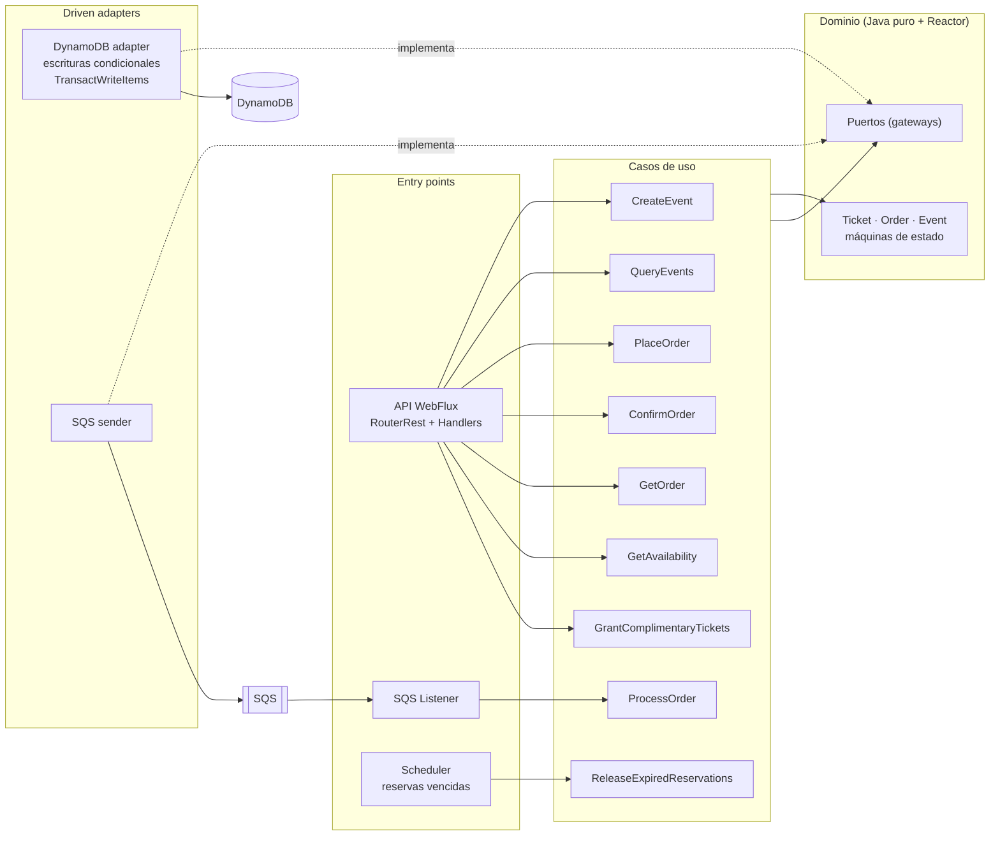
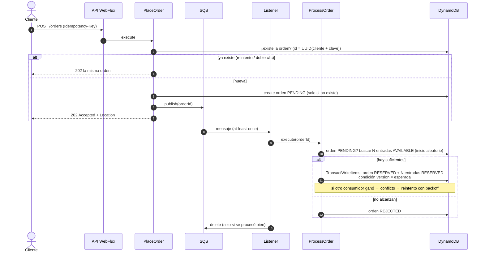
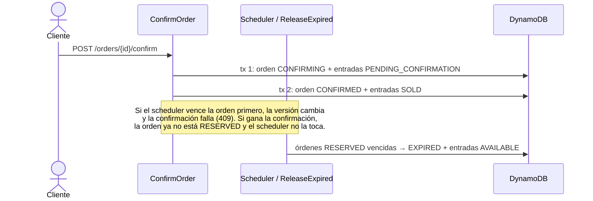
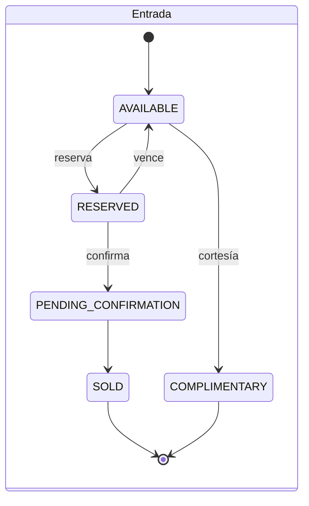
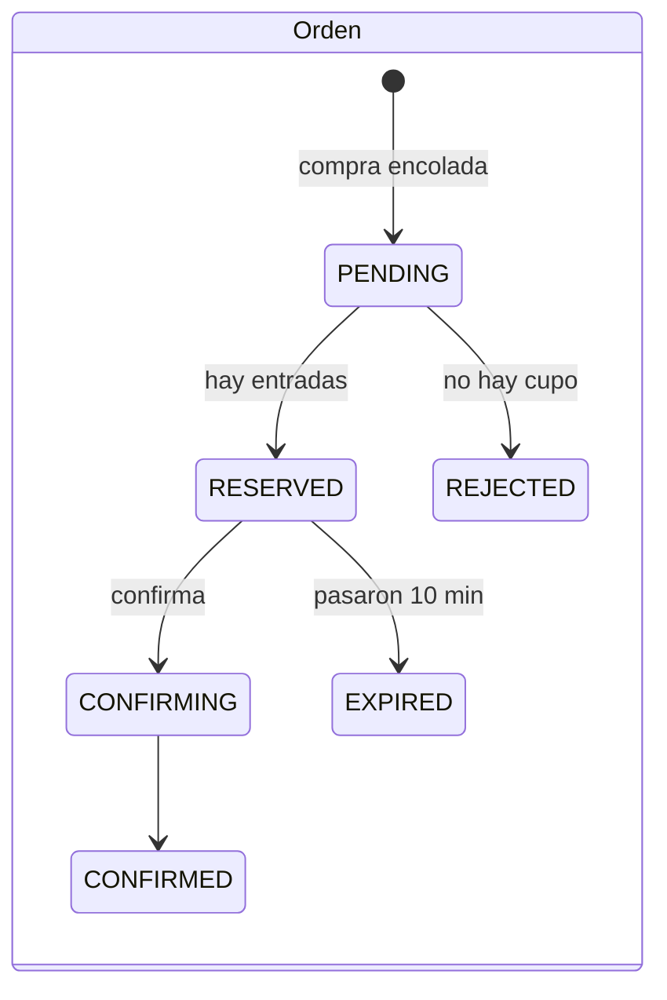
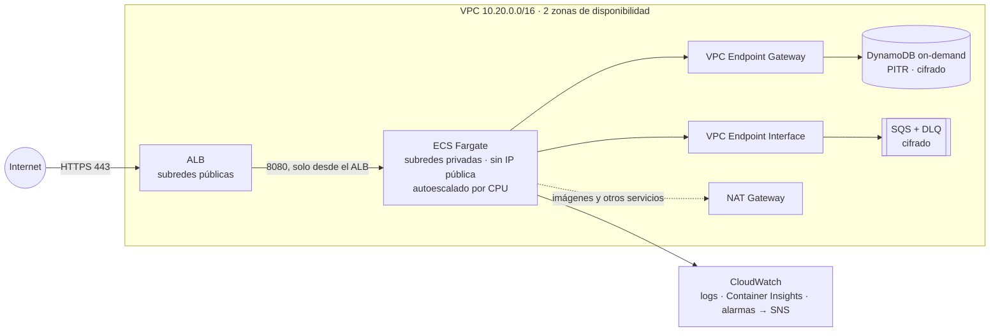

# Ticketing — Plataforma reactiva de procesamiento de compras de entradas

> CI en cada push (GitHub Actions): compila, corre los 255 tests (incluidos los de integración con DynamoDB Local) y **falla si algún módulo baja de 90% de cobertura**. También construye la imagen Docker y valida el Terraform.

Backend reactivo para vender entradas de eventos con picos de demanda **sin sobreventa**. La API recibe la compra, la **encola de inmediato** y responde con un número de orden. Un **consumidor asíncrono** reserva las entradas con **escrituras condicionales en DynamoDB**. Las reservas duran **máximo 10 minutos** y un proceso periódico libera las que vencen.

**Stack:** Java 25 · Spring Boot 4.1 · Spring WebFlux · DynamoDB (Local) · SQS (LocalStack) · Resilience4j · Docker · Clean Architecture (Scaffold Bancolombia) · JUnit 5 · Mockito · reactor-test · Testcontainers · ArchUnit · PIT.

---

## Contenido
1. [Cómo ejecutarlo](#1-cómo-ejecutarlo)
2. [Uso de la API](#2-uso-de-la-api)
3. [Arquitectura](#3-arquitectura)
4. [Flujos y máquinas de estado](#4-flujos-y-máquinas-de-estado)
5. [Decisiones de diseño y trade-offs](#5-decisiones-de-diseño-y-trade-offs)
6. [Concurrencia: cómo se evita la sobreventa](#6-concurrencia-cómo-se-evita-la-sobreventa)
7. [Seguridad](#7-seguridad)
8. [Pruebas](#8-pruebas)
9. [Limitaciones y qué cambiaría en producción](#9-limitaciones-y-qué-cambiaría-en-producción)
10. [Infraestructura como código en AWS (Terraform)](#10-infraestructura-como-código-en-aws-terraform)

---

## 1. Cómo ejecutarlo

### Requisitos
- Docker Desktop (con Docker Compose)
- *(Opcional, para correr sin Docker)* JDK 25

### Opción A: todo con Docker (recomendado)
```bash
docker compose up --build
```
Levanta 4 servicios:

| Servicio | Qué hace | Puerto |
|---|---|---|
| `dynamodb-local` | Base de datos (DynamoDB Local, en memoria) | 8000 |
| `localstack` | Cola SQS `ticketing-orders` y su DLQ | 4566 |
| `init-aws` | Crea las tablas, la cola y la DLQ (idempotente), y termina | — |
| `ticketing` | La aplicación (se compila dentro de Docker) | **8080** |

Verifica que esté arriba:
```bash
curl http://localhost:8080/actuator/health   # {"status":"UP"}
```
Para apagar todo: `docker compose down`

### Opción B: la app desde el IDE o Gradle y la infraestructura en Docker
```bash
docker compose up -d dynamodb-local localstack init-aws
./gradlew :app-service:bootRun        # perfil "local" por defecto
```

### Configuración (variables de entorno)
| Variable | Por defecto (perfil `local`) | Descripción |
|---|---|---|
| `RESERVATION_TTL` | `10m` | Duración de la reserva. **No puede superar 10 min**: el dominio lo valida al arrancar |
| `EXPIRATION_SWEEP_INTERVAL` | `30s` | Cada cuánto se liberan las reservas vencidas |
| `ORDERS_QUEUE_URL` | URL de LocalStack | Cola de órdenes. **Obligatoria fuera de local** (la app no arranca sin ella) |
| `DYNAMODB_ENDPOINT` / `SQS_ENDPOINT` | `localhost` | Solo en local. En AWS se usa el endpoint regional y el rol IAM |
| `TABLE_EVENTS`, `TABLE_TICKETS`, `TABLE_ORDERS` | `ticketing-*` | Nombres de tabla configurables (aislamiento de entornos) |
| `CORS_ALLOWED_ORIGINS` | `http://localhost:4200,...` | Orígenes permitidos |
| `ORDERS_PER_SECOND_PER_CUSTOMER` | `5` | Rate limit de compras por cliente (Resilience4j) |
| `ADMIN_API_KEY` | `local-admin-key` (solo en docker-compose) | Clave del endpoint de cortesías. **Sin valor, el endpoint queda deshabilitado.** En AWS viene de Secrets Manager |

---

## 2. Uso de la API

La colección de Postman está en [`postman/ticketing.postman_collection.json`](postman/ticketing.postman_collection.json). Encadena el flujo completo con variables.

Para ejecutarla completa desde la terminal con Newman (la app debe estar arriba con `docker compose up`):
```bash
docker run --rm -v "$(pwd)/postman:/etc/newman" postman/newman:6-alpine run ticketing.postman_collection.json   --env-var "baseUrl=http://host.docker.internal:8080/api/v1" --delay-request 1500   --folder "1. Events" --folder "2. Purchase flow" --folder "3. Errors"
```
La carpeta `4. Live stream (manual)` contiene el stream SSE, que no termina nunca; se observa en Postman o con `curl -N`.

| Método | Ruta | Descripción | Respuesta |
|---|---|---|---|
| `POST` | `/api/v1/events` | Crea un evento y su inventario | `201` |
| `GET` | `/api/v1/events` | Lista los eventos | `200` |
| `GET` | `/api/v1/events/{eventId}` | Consulta un evento | `200` / `404` |
| `GET` | `/api/v1/events/{eventId}/availability` | Disponibilidad en tiempo real | `200` |
| `GET` | `/api/v1/events/{eventId}/availability/stream` | Disponibilidad **en vivo** (Server-Sent Events) | `200` `text/event-stream` |
| `POST` | `/api/v1/events/{eventId}/complimentary` | **Cortesías** (admin, header `X-Admin-Key`): N entradas pasan a `COMPLIMENTARY`, final y no contable | `200` / `400` / `401` / `404` / `409` |
| `POST` | `/api/v1/orders` | Compra: **encola** y devuelve el id de la orden | **`202`** / `400` / `404` / `409` / `429` / `503` |
| `GET` | `/api/v1/orders/{orderId}` | Estado de la orden **y de cada entrada** | `200` / `404` |
| `POST` | `/api/v1/orders/{orderId}/confirm` | Confirma la compra: devuelve la orden con sus entradas en `SOLD` | `200` / `404` / `409` |

**Headers:** `X-Customer-Id` (cliente) en las operaciones de órdenes, e `Idempotency-Key` en la compra.

### Flujo completo con curl
```bash
# 1. Crear un evento con 10 entradas
curl -X POST localhost:8080/api/v1/events -H 'Content-Type: application/json' \
  -d '{"name":"Rock Fest","date":"2026-12-01T20:00:00Z","venue":"Movistar Arena","totalCapacity":10}'

# 2. Comprar 2 entradas (202 Accepted: la orden queda PENDING y se procesa en segundo plano)
curl -i -X POST localhost:8080/api/v1/orders -H 'Content-Type: application/json' \
  -H 'X-Customer-Id: ana' -H 'Idempotency-Key: compra-001' \
  -d '{"eventId":"<eventId>","quantity":2}'

# 3. Consultar la orden: RESERVED, con sus 2 entradas y la hora de vencimiento
curl localhost:8080/api/v1/orders/<orderId> -H 'X-Customer-Id: ana'

# 4. Confirmar: la orden pasa a CONFIRMED y las entradas a SOLD
curl -X POST localhost:8080/api/v1/orders/<orderId>/confirm -H 'X-Customer-Id: ana'

# 5. Disponibilidad (o en vivo: curl -N .../availability/stream)
curl localhost:8080/api/v1/events/<eventId>/availability
```

Respuesta de una orden (requisito 4: incluye el estado de cada entrada):
```json
{
  "orderId": "47c98d32-567a-3a69-a38f-aabc14e380a4",
  "status": "RESERVED",
  "reservedUntil": "2026-10-31T13:54:57.540Z",
  "tickets": [
    { "ticketId": "414be903-...-000005", "status": "RESERVED" },
    { "ticketId": "414be903-...-000001", "status": "RESERVED" }
  ]
}
```

### Errores
Todos responden con `{"status": <código>, "message": "..."}`:

| Código | Cuándo |
|---|---|
| `400` | Datos inválidos, falta un header o el JSON está mal formado |
| `401` | Falta la clave de administrador o es incorrecta (cortesías) |
| `404` | El evento o la orden no existe, **o la orden es de otro cliente** (no se revela que existe) |
| `409` | Transición inválida, reserva vencida, no hay entradas suficientes, **clave de idempotencia reutilizada para otra compra**, o conflicto de concurrencia (se puede reintentar) |
| `415` | Falta `Content-Type: application/json` |
| `429` | El cliente superó su límite de compras por segundo |
| `503` | La cola de órdenes no está disponible (circuit breaker abierto): se falla rápido |
| `500` | Error inesperado (sin detalles internos) |

---

## 3. Arquitectura

Clean Architecture generada con el [Scaffold de Bancolombia](https://github.com/bancolombia/scaffold-clean-architecture). **Las dependencias apuntan hacia adentro:** el dominio no conoce Spring, AWS ni Jackson (lo verifica `ArchitectureTest` con ArchUnit).



| Módulo | Contenido |
|---|---|
| `domain/model` | Entidades inmutables (records), máquinas de estado, excepciones `sealed` y puertos |
| `domain/usecase` | Un caso de uso por acción. Solo conoce el dominio y los puertos |
| `infrastructure/driven-adapters/dynamo-db` | Repositorios y transacción con `DynamoDbAsyncClient` (no bloqueante) |
| `infrastructure/driven-adapters/sqs-sender` | Publica el `orderId` en la cola |
| `infrastructure/entry-points/reactive-web` | API REST y SSE con router functions, y mapeo de errores a HTTP |
| `infrastructure/entry-points/sqs-listener` | Consume la cola y llama a `ProcessOrderUseCase` |
| `infrastructure/entry-points/scheduler` | Libera las reservas vencidas cada `EXPIRATION_SWEEP_INTERVAL` |
| `applications/app-service` | Arranque, configuración y wiring |

### Modelo de datos en DynamoDB (3 tablas)
| Tabla | Llave | Índices (GSI) | Para qué |
|---|---|---|---|
| `ticketing-events` | `eventId` | — | Eventos |
| `ticketing-tickets` | `ticketId` | `eventStatus` (`E1#AVAILABLE`) + `shuffle` · `orderId` | Buscar y **contar** entradas por estado; entradas de una orden |
| `ticketing-orders` | `orderId` | `status` + `reservedUntil` (**disperso**) | Encontrar las reservas vencidas |

---

## 4. Flujos y máquinas de estado

### Compra (asíncrona)


### Confirmación y expiración


### Máquinas de estado
La **entrada** usa los 5 estados del enunciado. La **orden** tiene su propio ciclo de vida (ver la decisión D1).




---

## 5. Decisiones de diseño y trade-offs

| # | Decisión | Por qué | Trade-off |
|---|---|---|---|
| D1 | **Dos máquinas de estado separadas (entrada y orden)** | El requisito 4 usa los estados de la *entrada* para describir la *orden*. Pero una orden puede ser rechazada o expirar, y agrupa varias entradas | La consulta de la orden devuelve **ambos**, así que el requisito se cumple literalmente |
| D2 | **Una sola fuente de verdad** | La relación orden↔entrada vive solo en `Ticket.orderId`; el vencimiento solo en `Order.reservedUntil`; la disponibilidad se **calcula** contando, no se guarda | Contar es más caro que leer un contador (ver §9) |
| D3 | **Orden + entradas en una sola transacción** (`TransactWriteItems`) | No existe un estado intermedio como "entradas reservadas con la orden PENDING" | Máximo 100 ítems por transacción (usamos ≤ 7) |
| D4 | **Compra idempotente**: `orderId = UUID(len:cliente:Idempotency-Key)` | Un doble clic o un reintento de red no crea 2 órdenes. No hace falta una tabla aparte. Si la clave se reutiliza con **otro evento u otra cantidad**, responde `409` en vez de devolver la orden vieja | — |
| D5 | **Consumidor idempotente** | SQS entrega *al menos una vez*: si la orden ya no está PENDING, se ignora el mensaje | — |
| D6 | **Reintentos solo de conflictos** (`Retry.backoff(3, 50ms)` con jitter) | Los errores de negocio (`sealed BusinessException`) siempre fallarían igual. Tras 3 conflictos el mensaje vuelve a SQS y, tras 5 intentos, a la **DLQ** | — |
| D7 | **Estado `CONFIRMING` en la orden** | La entrada debe pasar por `PENDING_CONFIRMATION`; cada transacción hace un solo cambio de versión. Si se cae a mitad, reintentar confirmar lo completa | Dos escrituras en vez de una |
| D8 | **Búsqueda con inicio aleatorio (`shuffle`)** | Con miles de consumidores, cada uno empieza en un punto distinto del índice y no pelean por las mismas entradas | — |
| D9 | **TTL configurable con tope en el dominio** | Operaciones ajusta la duración sin tocar código; el dominio impide superar los 10 min del requisito (*fail-fast* al arrancar) | — |
| D10 | **Cliente DynamoDB directo + mappers explícitos** | La plantilla del Scaffold no soportaba escrituras condicionales, transacciones ni conteos y solo leía una página | Más código de mapeo, pero sin magia |
| D11 | **Sin Virtual Threads** | WebFlux ya es no bloqueante. Los Virtual Threads resuelven el mismo problema, pero para código bloqueante | — |
| D12 | **Records en vez de Lombok** | Inmutabilidad nativa de Java y dominio sin dependencias | — |
| D13 | **Resiliencia en dos niveles** | Los reintentos por concurrencia son **regla de negocio** (una sola política, `ConflictRetry`, en los casos de uso). Las fallas de **infraestructura** se manejan con Resilience4j en los bordes: rate limiter por cliente en la compra (en una caché acotada que expira, para que rotar `X-Customer-Id` no agote la memoria), circuit breaker en el envío a SQS y timeouts del SDK | El rate limiter vive en memoria de cada instancia (ver §9) |

### Java moderno usado
Records (16) · `switch` exhaustivo (14) · `sealed` (17) · *pattern matching* en `switch` (21) · variables sin nombre `_` (22) · `List.getFirst()` de colecciones secuenciadas (21) · `String.formatted` (15).

---

## 6. Concurrencia: cómo se evita la sobreventa

1. **Optimistic locking real:** cada escritura lleva `ConditionExpression: version = :expected`. Si otro proceso cambió el ítem, **DynamoDB rechaza** la escritura (`ConditionalCheckFailed`), y el adaptador la traduce a `ConcurrencyConflictException`.
2. **Atomicidad:** la orden y sus N entradas se escriben **todo o nada**.
3. **Defensa contra lecturas viejas:** antes de escribir, `Order.requireOwnTickets` verifica que la orden vea exactamente sus N entradas en el estado esperado, porque los GSI son eventualmente consistentes.
4. **Carrera confirmar ↔ expirar:** la decide la versión de la orden (ver el diagrama).

**Evidencia:**
- `DynamoRepositoriesIntegrationTest.shouldNeverHandTheSameTicketsToTwoConcurrentTransactions`: 10 transacciones simultáneas por las mismas 2 entradas contra **DynamoDB Local real** → gana exactamente 1.
- Prueba de punta a punta con docker-compose: **10 compras simultáneas de 2 entradas para 8 disponibles → 4 `RESERVED`, 6 `REJECTED`, disponibilidad final 0**.

---

## 7. Seguridad

| Riesgo | Mitigación |
|---|---|
| Reintentos maliciosos y doble clic | Compra idempotente (D4) y consumidor idempotente (D5) |
| Ver o confirmar la orden de otro | Se verifica el dueño; se responde `404` (no `403`) para no revelar qué ids existen. Las entradas también validan su orden dueña |
| Abuso de recursos | **Rate limiter por cliente** en la compra (`429`), máximo **6 entradas por orden** y **100.000** por evento, validación **antes** de leer la base de datos, y el stream SSE se corta a los 10 min |
| Fuga de información | Los `500` no exponen detalles; headers de seguridad (CSP, HSTS, `nosniff`); CORS restringido a orígenes configurados |
| Operaciones de administrador | Las cortesías exigen `X-Admin-Key`, comparada en **tiempo constante** (evita *timing attacks*). Si la clave no está configurada, el endpoint queda **deshabilitado**, no abierto. Máximo 10 por petición |
| Secretos y credenciales | **No hay credenciales en el código ni en el repositorio.** La clave de admin se inyecta desde **Secrets Manager** en AWS. En AWS se usa la cadena por defecto (rol IAM / web identity); en local, credenciales de mentira solo cuando hay un endpoint local |
| Contenedor | Imagen de runtime solo con JRE y usuario **no root** |

---

## 8. Pruebas

```bash
./gradlew test jacocoTestReport -x pitest   # todos los tests + cobertura (los de integración necesitan Docker)
./gradlew :model:pitest :usecase:pitest     # pruebas de mutación del dominio y los casos de uso
```

**Cobertura de líneas (JaCoCo): 96% en total** (744 de 774 líneas) · **255 tests** · PIT en el dominio y los casos de uso.

| Módulo | Cobertura |
|---|---|
| `domain/model` | 92% |
| `domain/usecase` | **100%** |
| `dynamo-db` | 94% |
| `sqs-sender` | 100% |
| `sqs-listener` | 100% |
| `reactive-web` | 99% |
| `scheduler` | 95% |
| `helpers/metrics` | 100% |
| `app-service` | 0% (solo `main` y la configuración de beans; fuera del gate) |

**Quality gate:** `./gradlew check` aplica `jacocoTestCoverageVerification` con **mínimo 90% de líneas por módulo** (excepto `app-service`) y hace fallar el build si no se cumple. El pipeline [`ci.yml`](.github/workflows/ci.yml) lo ejecuta en cada push y en cada pull request.

| Tipo | Herramienta | Qué cubre |
|---|---|---|
| Unitarias de dominio | JUnit 5, `@ParameterizedTest` | Las 25 + 36 transiciones de estado, invariantes y valores límite |
| Casos de uso | Mockito + `StepVerifier` (con tiempo virtual para los reintentos) | Flujos felices, errores, idempotencia y carreras entre consumidores |
| Componentes reactivos | `WebTestClient` | Endpoints, códigos HTTP y SSE |
| Integración | **Testcontainers + DynamoDB Local** | Escrituras condicionales, transacciones, índices y concurrencia real |
| Arquitectura | ArchUnit (`ArchitectureTest`) | Reglas de Clean Architecture |
| Mutación | PIT | Que los tests detecten cambios reales en la lógica del dominio |

---

## 9. Limitaciones y qué cambiaría en producción

| Hoy | En producción |
|---|---|
| La disponibilidad **cuenta** el índice en cada consulta (barato hasta miles de entradas) | Un contador desnormalizado por evento, actualizado **en la misma transacción** que la reserva, y/o una caché corta |
| Auditoría: cada transición persistida queda en el logger `audit.transitions` (orden, estado, versión, cliente y estado de cada entrada), y `version` cuenta los cambios | Una tabla de historial escrita en la misma transacción, o DynamoDB Streams → S3, con retención |
| `X-Customer-Id` por header (no había autenticación en el alcance) | Identidad desde un JWT (Cognito / API Gateway authorizer) |
| El pago está fuera del alcance: confirmar = pagar | Integración con una pasarela y su webhook; `PENDING_CONFIRMATION` mientras se espera el pago |
| Índice de vencimientos con una sola partición `RESERVED` | Particionar por evento o por bucket de tiempo para evitar una partición caliente |
| Crear un evento de 100.000 entradas son ~4.000 `BatchWriteItem` en la petición | Crear el inventario de forma asíncrona (cola), con estado "publicando" |
| Rate limiter en memoria por instancia | Rate limiting distribuido (API Gateway usage plans / WAF o Redis) |
| Métricas en `/actuator/prometheus` y alarmas de CloudWatch (DLQ, cola atrasada, 5xx, throttling) en Terraform | Dashboards (CloudWatch / Grafana) y trazas distribuidas (OpenTelemetry / X-Ray) |
| Cortesías protegidas por una clave compartida de admin, y sin clave de idempotencia (un reintento del admin otorga N más) | Roles con un IdP (JWT con scope `admin`), `Idempotency-Key` también en las cortesías y auditoría de quién otorgó cada una |
| Cada conexión SSE consulta la disponibilidad por su cuenta (cortada a los 10 min) | Un publicador compartido por evento (`share()`) y un límite de conexiones por cliente |
| No se valida que la fecha del evento sea futura | Rechazar eventos en el pasado y cerrar la venta cuando el evento ya ocurrió |

---

## 10. Infraestructura como código en AWS (Terraform)

En [`deployment/terraform/`](deployment/terraform) está el despliegue en AWS. Está validado con `terraform validate` (no se aplicó a una cuenta real).



```bash
cd deployment/terraform
terraform init -backend-config=environments/dev.backend.hcl
terraform plan  -var-file=environments/dev.tfvars
terraform apply -var-file=environments/dev.tfvars

# Antes de que el servicio arranque: cargar la clave de admin en el secreto que creó Terraform
# (vacío a propósito, para que el valor nunca quede en el código ni en el estado de Terraform)
aws secretsmanager put-secret-value --secret-id ticketing-dev/admin-api-key --secret-string '<clave-segura>'
```

| Archivo | Contenido |
|---|---|
| `network.tf` | VPC, subredes públicas y privadas en 2 AZ, NAT, VPC endpoints y security groups |
| `data.tf` | Las 3 tablas DynamoDB con sus índices, y la cola SQS + DLQ |
| `iam.tf` | Rol de ejecución, rol de la app con mínimo privilegio, y el secreto de la clave de admin en Secrets Manager |
| `compute.tf` | ECR, ECS Fargate, ALB con HTTPS (TLS 1.3) y autoescalado |
| `observability.tf` | Alarmas y notificación por SNS |
| `environments/*.tfvars` / `*.backend.hcl` | Diferencias entre `dev` y `prod` y su estado remoto separado |

### Decisiones
| Tema | Decisión | Por qué |
|---|---|---|
| **Networking** | La app vive en **subredes privadas**; solo el ALB es público. **VPC Endpoints** para DynamoDB (gateway, gratis) y SQS | El tráfico a los servicios de AWS no sale a internet, y se ahorra el costo de datos por NAT |
| **Seguridad** | Security groups encadenados (internet → ALB:443 → app:8080). Rol IAM **de mínimo privilegio**: solo las acciones que usa la app, sobre sus 3 tablas, sus índices y su cola. Cifrado en reposo en DynamoDB y SQS. TLS 1.3 en el ALB. ECR con imágenes **inmutables** y escaneo de vulnerabilidades. **Sin credenciales de AWS en la app** (usa el rol de la tarea); la única clave, la de admin, llega desde **Secrets Manager** y nunca queda en el código ni en el estado de Terraform | Defensa en profundidad; un contenedor comprometido no puede tocar otros recursos |
| **Escalabilidad** | DynamoDB **on-demand**; ECS con autoescalado por CPU (1-2 tareas en dev, 2-10 en prod) en 2 AZ | Las ventas de entradas son picos impredecibles: on-demand los absorbe sin aprovisionar capacidad |
| **Resiliencia** | 2 AZ, *deployment circuit breaker* con rollback automático, PITR (recuperación a cualquier punto de los últimos 35 días) y *deletion protection* en prod | Un despliegue roto se revierte solo; no se pierden datos |
| **Aislamiento de entornos** | El mismo código con `dev.tfvars` / `prod.tfvars` y **un estado remoto por entorno** (S3 con bloqueo). Nombres con sufijo de entorno | `dev` no puede romper `prod`; los cambios se prueban primero en dev |
| **Costos** | Pago por uso en DynamoDB y Fargate. **1 NAT en dev, 1 por AZ en prod**. Logs con 7 días de retención en dev y 90 en prod | El NAT y los logs son los costos ocultos típicos |
| **Observabilidad** | Logs centralizados, Container Insights y alarmas: **mensajes en la DLQ**, cola atrasada (> 60 s), errores 5xx y throttling de DynamoDB, notificadas por SNS | Se detectan las órdenes que nadie pudo procesar y cuando los consumidores no dan abasto |
| **Gobernanza** | `default_tags` en todos los recursos: Project, Environment, Owner, CostCenter, ManagedBy | Reporte de costos por equipo y entorno, y auditoría de quién es dueño de qué |

**Siguientes pasos en una cuenta real:** pipeline de CI/CD (build → escaneo → push a ECR → `terraform plan` revisado en el PR), WAF delante del ALB (rate limiting distribuido), autoescalado también por la profundidad de la cola SQS, y alarmas de presupuesto (AWS Budgets).

